假设今晚我也来抢这台手机。倒计时归零，我按下「立即抢购」。按钮灰了，页面转了一会儿，跳出三个字：排队中。我的手指还悬在屏幕上。再点一次，会不会有两个订单？不点，刚才那一下到底算不算数？

<!-- more -->

我带着这个疑问去看程序员小Dan讲的秒杀案例。课里备了 1,000 台手机，零点第一秒进来 8 万个下单请求，数据库连接池只有 50 个连接。有人等到超时，重试又挤进来。系统停了 20 分钟，恢复后再盘库存，手机多卖了 **47 台**。

那 47 台让我惦记了很久。假如我的订单也在里面，页面上明明写着成功，仓库却找不出一台手机给我。于是我想换个位置：就当这次抢购由我来写。从自己的这一下点击开始，我什么时候有把握告诉屏幕另一头的人——可以付款了？

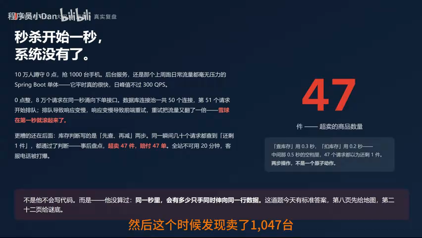

*视频里的事故现场。左边是请求怎样越积越多，右边是事后清点出来的 47 件超卖商品。*

## 我的请求，先卡在了哪里？

我先把服务缩小到一台机器。假设 Tomcat 有 200 个工作线程，每条线程接一个请求，查库，拿到结果，再接下一个。一次占用 50 毫秒，一条线程一秒理想情况下能接 20 单，200 条就是 **4,000 QPS**。现在数据库慢了，一次要等 500 毫秒。再做一遍同样的除法：**400 QPS**。

这下我知道为什么光盯着 CPU 会看走眼了。那多出来的 450 毫秒里，线程可能一直在等连接、等锁、等磁盘。它没做多少运算，手头的请求却还没交差。换作我在手机上等，只觉得按钮转了好久；换到后台看，这段时间里一条线程始终腾不出来。

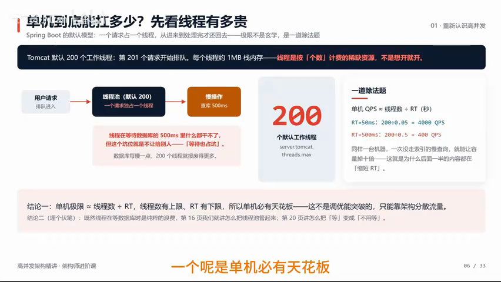

*把手指放在图里「慢操作」的位置，就能看到等待是怎样把前面的线程池占满的。*

为了把这段等待量清楚，我会在接口入口记三件事：眼下还有多少个请求没结束（并发数），这一秒完成了多少个（吞吐量），进来一趟平均花多久（响应时间，RT）。在相同观察范围内，流量稳定时，这三个数可以互相验算。

> **平均在途请求数 ≈ 每秒完成的请求数 × 平均响应时间（秒）**

比如每秒完成 2,000 次、平均耗时 0.1 秒，接口里就平均有约 200 个请求在途。这里我得留个心眼：拿手机上的总耗时去乘，结果会把排队也算进去；想估线程上限，得用线程实际被占用的时间。回到课程案例，就算应用有 200 条线程，那个池里同时可借出的数据库连接也只有 50 个。

### 要是有人问我「这套服务能扛多少」

我会先讨两个数：大家一天来多少次，又喜欢挤在哪个时段？课程举了一个日活 100 万的例子。先把平时的忙时算明白，再单独看零点那一秒。

| 估算步骤 | 计算 | 得到什么 |
| --- | --- | --- |
| 全天请求量 | 100 万 × 20 | 2,000 万次/日 |
| 忙时平均吞吐 | 80% 的请求集中在全天 20% 的时间，即 1,600 万 ÷ 17,280 秒 | 约 926 QPS |
| 峰值设计目标 | 926 × 3，留出忙时内的波动空间 | 约 2,800 QPS |

算到 2,800，我会在旁边写上「待压测」。毕竟我自己就是会提前打开页面、盯着倒计时的人。十万人约好零点按按钮，当然不会体贴地把点击均摊到一天里。还有，刷十次商品图和下十笔订单，对数据库的分量也差得远。

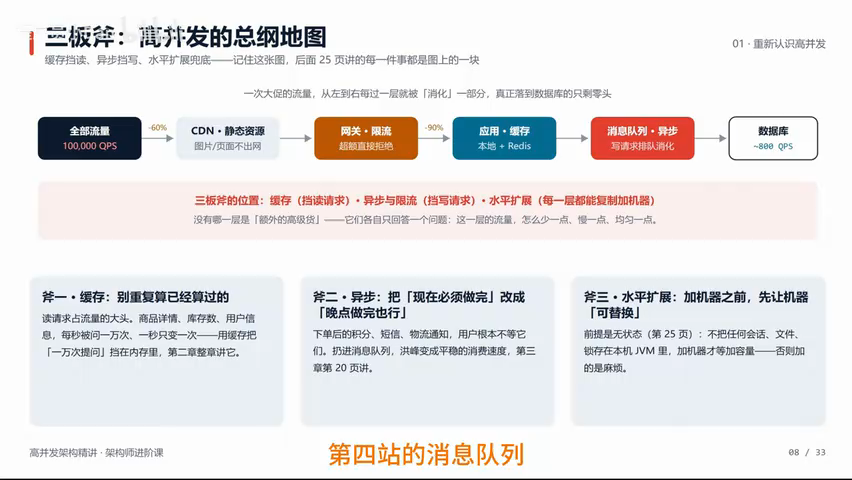

*课程用入口 10 万 QPS、到库约 800 QPS 示意分层后的量级。实际到库量，要按各类请求的命中率、放行率和写入量分别算。*

## 开抢前，我已经刷新了好几遍

我第一次点进详情页，看颜色、内存，再放大主图。过一会儿怕错过时间，又刷新一遍。两次打开之间，那张手机背面的照片连一个像素都没变。为我第二次看同一张图，再叫醒一次数据库，实在冤枉。顺着这页上的内容往回找，我会把它们放在这些地方。

| 请求需要什么 | 可以在哪里回答 | 选这一层的理由 |
| --- | --- | --- |
| 再次打开相同版本的图片或样式 | 浏览器缓存 | 资源仍然有效时，用户设备可以直接复用。 |
| 活动页、商品大图、活动规则 | CDN 边缘节点 | 活动前生成静态页面，让多数浏览停在离用户较近的节点。 |
| 相同参数、可共享的热点响应 | 网关缓存 | 合并短时间内的重复访问。含用户私有信息的响应要区分身份。 |
| 极热、读多写少的商品信息 | JVM 本地缓存，如 Caffeine | 省一次网络往返，要付出堆内存，并接受实例之间短暂的版本差异。 |
| 多个应用实例共享的商品详情 | Redis | 各实例复用同一份结果，缓存未命中时再查数据库。 |

数据库真正关心的是漏下来的那一小撮。假设我这里每秒有一万次相同类型的读，95% 命中缓存，就有 500 次要回源。哪天监控从 95% 滑到 90%，一眼看上去只掉了五个点，数据库收到的活儿却从 500 次变成了 **1,000 次**。

### 我刷新了页面，怎么还是原价？

假设活动价从 3,000 元改成 2,800 元。我用旁路缓存（Cache Aside）做商品详情，平时先查缓存，找不到才去数据库，把结果存回来，顺手设好有效期（TTL）。改价时，我先提交数据库事务，再删掉旧详情。等下一位顾客打开页面，再按新价拼一份。

起初我也想过，改价时顺手把缓存里的价格改了，多省事。可一张详情卡里还有活动文案和优惠信息，可能来自好几张表。两次编辑赶在一起，先算好的那份甚至可能最后才写进去。删掉旧卡片，让下一次读取从数据库重建，事情反倒容易讲清。

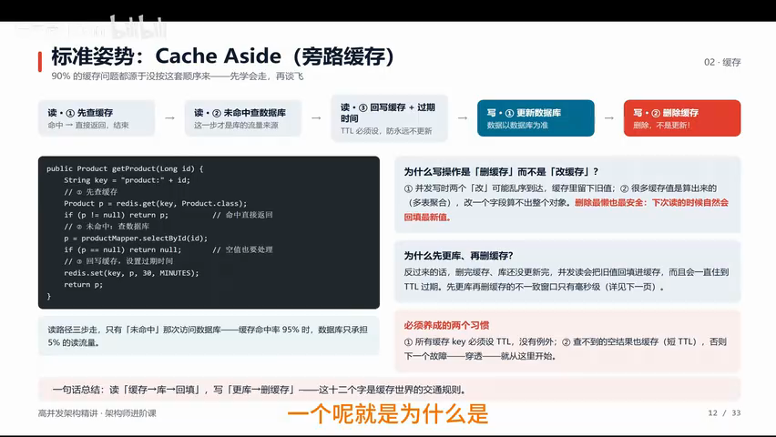

*读路径里，查库只在未命中时发生。写路径里，数据库提交和缓存失效是两个独立动作。*

最绕的是把顺序倒过来。假设后台先删缓存，我恰好在这一瞬间刷新。缓存空了，我去数据库取回 3,000 元。就在返回的路上，新价 2,800 元提交成功。接着我把刚读到的 3,000 元写回缓存。好嘛，下一位顾客点进来，旧价又堂堂正正地摆在页面上了。

所以我选先更库、后删缓存，也会给删失败的操作留一条重试路径，或者订阅数据库变更日志补删。如果碰到很晚才回来的旧读，还可以隔一会儿再删一次，也就是延迟双删。等多久，要看一次慢读和回填实际花多久。至于结账，我希望页面把最终成交价讲清楚；缓存里一张过时的详情卡，做不了付款凭据。

### 都是数据库突然忙起来，我该查哪个键？

我以前容易把穿透、击穿、雪崩三个词记混。带回这个商品页就好分了：是有人一直查一台压根没上架的手机，是今晚的爆款恰好过期了，还是整批商品同时没了缓存？先认出是哪一种，再动手。

| 现象 | 到底发生了什么 | 有针对性的处理 |
| --- | --- | --- |
| 穿透 | 查不存在的商品，缓存和数据库都没有结果。 | 对重复的无效 ID 短暂缓存空值。无效 ID 很分散时，可用布隆过滤器排除确定不存在的键。 |
| 击穿 | 一个热门商品的键过期，成千上万的读者一起重建同一份详情。 | 只允许一个请求回源重建。能接受短暂旧值时，也可先返回旧值，再异步刷新。 |
| 雪崩 | 成批键同时过期，或整个缓存节点不可用。 | 错开 TTL，避免批量预热后的集中失效。节点故障还需要高可用、限流和降级。 |

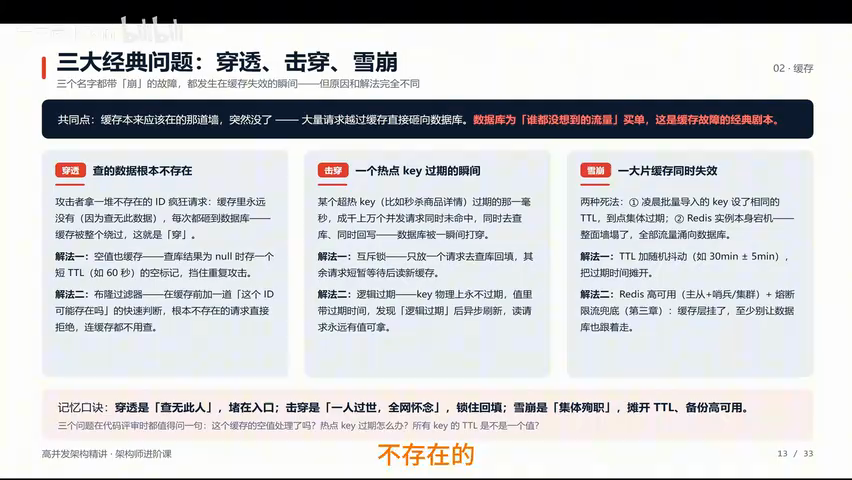

*同样是回源量猛增，“从未存在的键”“一个热门键”和“一大片键”指向三种不同的处理方式。*

## 倒计时归零，我点了。再点一下呢？

等页面转圈的时候，我很容易再按一下，理由也很朴素：万一刚才没点上呢？作为写接口的人，我不能指望十万个人都比我有耐心。前端把按钮置灰，能省掉不少重复点击；到了服务端，仍得核对用户、活动资格和这次操作的凭证。把每一下都送到数据库，最后争的还是同一行库存。

### 队伍要排多长，我才肯让人进来？

我先估能同时干活的线程数。对阻塞式 I/O，课程给的起点是「核数 ×（1 + 等待时间 ÷ 计算时间）」。8 核，每次算 100 毫秒、等 400 毫秒，可以先用 40 条线程压测。如果这 40 条大多在抢数据库连接，我会先去看连接被谁占着。再多开几十条，只是多了几十个等位的人。

队列尤其容易给我错觉：请求收进来了，仿佛事情就办成一半了。可要是用户已经等到超时、退出页面，三十秒后后台才轮到这笔操作，他怎么知道自己还有没有单？我会给队列设上限，给下游设超时，一起看活跃线程、积压和拒绝数。满了就明确告知用户，或者在调用方能承压时，让调用线程亲自执行，把提交速度降下来。

### 每分钟限 100 次，会不会一秒进来 200 次？

| 算法 | 放行规则 | 能从用户侧观察到的差别 |
| --- | --- | --- |
| 固定窗口 | 每分钟最多放行 100 次，到点清零。 | 前一分钟末和后一分钟初可能各通过 100 次，短时间涌入近 200 次。 |
| 滑动窗口 | 把时间切成更小的格子，统计最近一段时间的总量。 | 跨分钟边界更平滑，精度取决于格子的大小。 |
| 漏桶 | 允许请求进入有界队列，按约定的速度流出。 | 下游看到的速率较平稳，用户可能等待，队列满时拒绝。 |
| 令牌桶 | 按固定速率补充令牌，拿到令牌才放行。 | 平时积下的令牌允许一阵短促突发，长期平均速率仍受限。 |

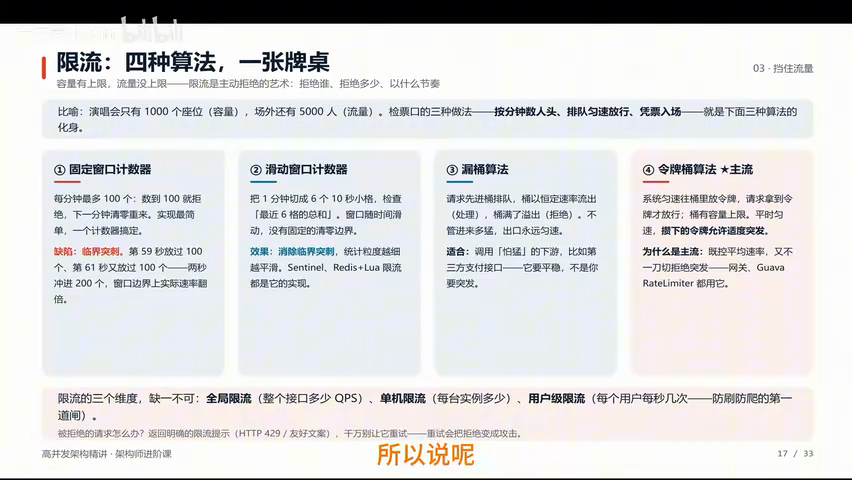

*如果上一分钟最后一瞬间来了 100 次，下一分钟刚开始又来 100 次，固定窗口的两次计数都很规矩，下游却实实在在挨了两拨。*

给单个用户限频，我会尽量在网关就处理，超额时返回 HTTP 429。核心接口还可以用 Sentinel 单独设限、逐步预热。设规则时有个小坑：十台机器，每台每秒放 100 次，合起来可能是 1,000 次。活动若只有一份全站预算，就得共用计数，例如用 Redis 和 Lua 原子更新。至于预算填几，后面的压测才是依据。

### 手机我都挑好了，为什么要等「猜你喜欢」？

假如我已经把颜色、内存选好，连收货地址都填完了，这时推荐服务卡住，让我陪它等，多少有些不讲理。熔断器做的事很好理解：平时照常调用，记录慢调用和错误；达到阈值，暂时停调。等一会儿，放几次请求试一试。探测成功就恢复，还是慢就再等等。这三种状态叫关闭、打开和半开。

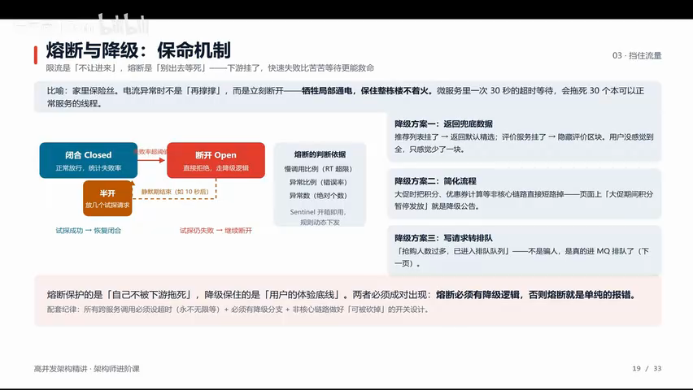

*看图时把两件事分开：熔断器决定还调不调下游，降级逻辑决定此时用户能看到什么。*

作为顾客，我大概不会介意今晚少看一排推荐，晚几分钟收到积分也行。可我会很在乎「排队中」这三个字究竟算什么。若后台已经可靠地收下我的请求、给我一个能查询的结果，我愿意等。若连请求都没记住，这行字只会让我舍不得关掉页面。

## 只剩一台，我和你都看见了「有货」

现在假设只剩最后一台。我们俩同时点下去，我这边读到 1，你那边也读到 1。两边都算出「1 减 1 等于 0」，也都把 0 写了回去。运营打开库存表，数字好端端地停在零；打开订单表，才看见有两个人等着收货。**库存从头到尾都没负过，这台手机照样卖了两次。**

如果这段代码由我写，我会把「还有吗」和「给我留一件」交给数据库一次做完：

```sql
UPDATE seckill_stock
SET stock = stock - 1
WHERE sku_id = ? AND stock > 0;
```

关键在最后那几个字。假设我们俩都更新同一条商品记录，第一个事务把库存从 1 扣到 0 并提交，第二个再执行更新时，条件已经不成立。接下来应用还得看一眼影响行数：拿到 1 才能往下走，拿到 0 就该告诉对方售罄。少看这一眼，数据库守住了库存，页面照样敢报喜。

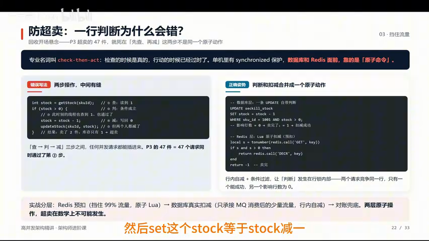

*图中的两次原子操作各自保护一份数据：Redis 决定是否发放预占名额，数据库决定真实库存是否扣减成功。*

不过，让八万人挨个找数据库问一遍「还有吗」，还是太贵。我会把第一轮预占放进 Redis，用 Lua 在一次执行里完成判断和扣减。售罄的请求到这里就结束，拿到名额的再去建单。这里有个容易让人高兴早了的区别：Redis 给我留了一份名额，并不等于订单已经落库。中间那条建单消息发没发到、会不会发两遍，还得有人管。

### 我还要为这台手机再加一把锁吗？

就上面这条 SQL 而言，我会停手。数据库已经把判断和扣减合成一步了。换个场景，若多台 JVM 上有一段业务确实要互斥执行，单机的 `synchronized` 才会力不从心。这时可按「用户＋商品」等粒度使用共享锁，给等待设上限，在异常路径也由持有者释放。用 Redisson 时，显式指定固定租期和让看门狗自动续期是两种模式。业务跑得比固定租期更久，后一个请求可能在前一个做完之前就进来。

### 十秒钟的洪峰，要用多久消化？

如果我抢到了一个名额，我能接受短信晚到几秒。先把建单任务可靠地投递进消息队列，订单服务就能按数据库承受得起的速度处理。这里我最怕一个很普通的插曲：订单已经建好，消费确认却丢了，同一条消息又来一遍。用稳定的订单号做幂等，就是让后台看得出「这单刚才办过」，别再扣我一件库存。

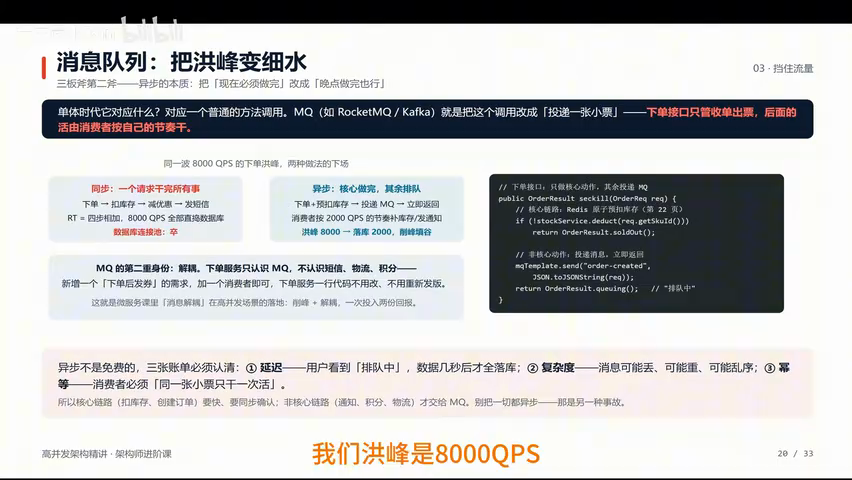

*同步路径把等待留给用户，异步路径把部分等待移进队列。两者都要为实际的写入工作付出资源。*

队列要存多少？假设一秒进 8,000 条，只能办完 2,000 条，十秒后就攒下 **60,000 条**。即使此刻入口彻底安静，也还要约 30 秒才能清空。换到手机这头，那就是盯着「排队中」等上半分钟。如果连消息都没投进去，等再久也等不来订单。因此预占得有记录，投递失败得能补偿，用户离开页面再回来，也应该查得到刚才那一单。

### 把刚才那一下点击，从头对一遍

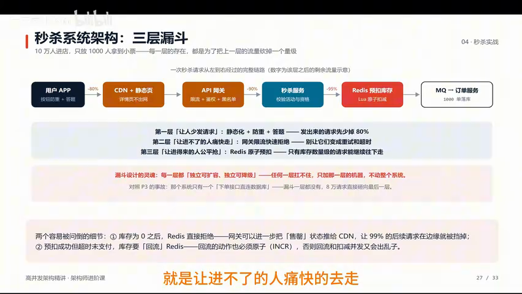

*沿箭头从左向右看，请求的单位在变化：最初是一次访问，中间是一次抢购尝试，最后才是一份值得落库的订单。*

**我按下按钮时**

1. 用户点击抢购。按钮置灰减少重复点击，提交时携带一次性凭证。
2. 网关检查登录状态、访问频率和黑名单，超额请求在这里结束。
3. 秒杀服务核对活动时间、购买资格，以及用户是否已参与。

**页面告诉我「排队中」时**

4. Redis 原子检查并预扣一份可售库存。
5. 预扣失败就返回售罄。售罄状态可以传到更靠前的层级，减少后续无效请求。
6. 预扣成功后可靠投递建单消息，向用户返回可查询的受理状态。
7. 消费者按订单标识幂等建单，重投的消息不会生成第二笔订单。
8. 数据库执行带库存条件的扣减。建单状态与扣减结果要协调，失败时进入明确的回滚或补偿路径。

**我去付款，或者临时改了主意**

9. 用户支付后确认订单。课程示例为 15 分钟未支付自动关单；取消时释放预占，并防止重复关单把一份名额加回两次。
10. 用户可以查询或接收处理结果，在订单可支付时继续支付，在失败或关闭时结束等待。
11. 后台按一致的库存口径核对可售量、未付预占和已确认订单。出现差异时能定位到具体订单，才能知道该补建、释放还是人工处理。

## 等订单的时候，顺便看看数据库在忙什么

假设客服要帮我查「今天的订单」。人只问了一天，数据库却可能翻过两百万行。一个很顺手的写法是给索引列套上 `DATE(create_time)`，再和日期比较。意思一眼就懂，普通时间索引却可能用不上。我更愿意把起点和终点直接交给数据库：从今天零点开始，到明天零点为止。

```sql
SELECT order_id, create_time
FROM orders
WHERE create_time >= '2026-10-25 00:00:00'
  AND create_time <  '2026-10-26 00:00:00';
```

课件里，这点改动让扫描量从约 200 万行降到约 5,000 行，耗时从 1.8 秒降到 3 毫秒。我不会把这个倍数直接套到自己的表上，但会先翻慢查询日志，挑那些反复出现、每回又翻很多行的 SQL，用 `EXPLAIN` 看执行计划。索引前缀、类型转换、深分页和长事务，都值得在买新机器之前看一眼。

### 数据库喊忙，我会先看它忙的是什么

| 观测到的瓶颈 | 值得先尝试什么 | 随之要处理的问题 |
| --- | --- | --- |
| 普通读占大头，主库读压力高 | 把可容忍延迟的读分给从库。 | 复制有延迟，用户刚改完资料后的读取可能需要走主库。 |
| 订单表很大，绝大多数查询只看近期订单 | 归档历史订单，缩小热数据集。 | 历史查询要有明确入口，也要验证归档后热查询确实变快。 |
| 写压力分布在大量独立订单上，单库已成瓶颈 | 按常用访问路径选择分片键并评估分库分表。 | 跨片查询、全局 ID、迁移和跨库事务会增加成本。 |
| 大家争的是同一个爆款商品 | 在入口预扣，并缩短真实扣减事务。 | 给订单表加分片，仍然解决不了对同一库存行的争抢。 |

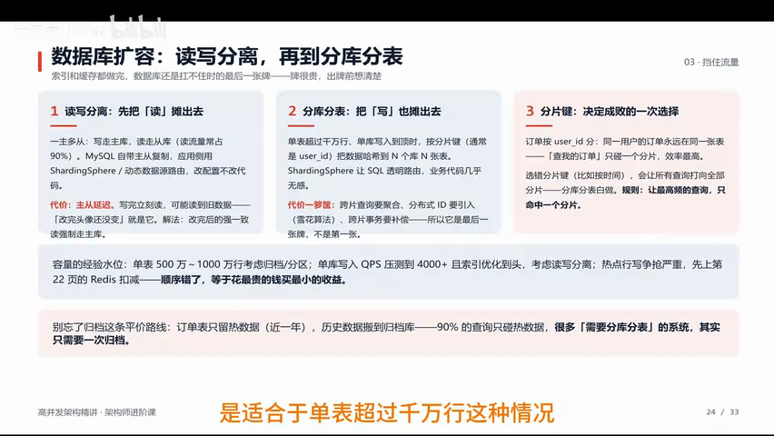

*以“我的订单”为例，按用户分片可以让常见查询只访问一个分片。分片方案要从最常执行的查询反推。*

轮到应用扩容，我会做个很生活化的试验：登录，选好手机，然后在付款前把当前实例的流量全切走。再点一下，如果页面突然请我重新登录，多半有会话只存在旧机器上。会话放到共享存储，文件放对象存储，定时任务协调执行，本地只留丢了也能重建的缓存。做到这一步，新加一台机器，才真的有人能去它那儿结账。

## 活动前夜，我敢在容量表上填多少？

还记得前面铅笔写下的 2,800 QPS 吗？现在该拿数据来对了。下面是课程里的 JMeter 阶梯压测，每档大约跑三分钟。我会先遮住最后一列，只看吞吐，试试自己会在哪一行停下来。

| 并发数 | 吞吐量 | 响应时间 | 错误率 |
| ---: | ---: | ---: | ---: |
| 50 | 920 QPS | 54 ms | 0% |
| 100 | 1,740 QPS | 57 ms | 0% |
| 200 | 2,870 QPS | 70 ms | 0% |
| **400** | **2,910 QPS** | **137 ms** | **0.2%** |

只报最高成绩，我可以写 2,910 QPS。可把手指移回上一行，200 并发已经有 2,870 QPS 了。再加 200 个并发，只多做了 **40 次/秒**，大家等的时间却从 70 毫秒涨到 137 毫秒。再看刚才遮住的错误率：已经有人请求失败了。这是我会圈出来继续排查的一档，拿它当日常容量，余量实在太薄。

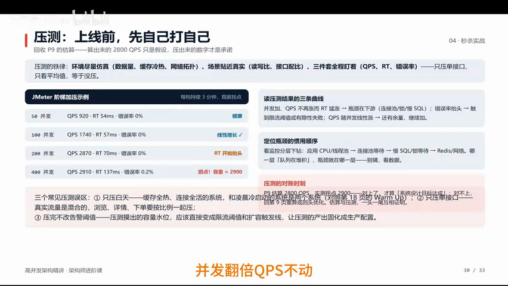

*看最后两行的三个指标：吞吐几乎走平、耗时上升、错误出现，这比单独报告一次最高 QPS 更能说明问题。*

我会在这一档同时翻几条曲线：谁先开始排队，应用线程、数据库连接，还是热点行的锁？缓存一冷下来，这个结果还成立吗？测试时还要把浏览和下单按实际比例混在一起，带上接近生产的数据量，看慢的那批用户等了多久。毕竟轮到我抢的时候，「平均挺快」对着屏幕上的转圈也没什么安慰。

## 我什么时候敢让你去付款

假如明晚就要开抢，我想在下班前亲手试两回。

第一回，把浏览、刷新、下单一起压上去，直到系统开始拒绝请求。我会留一部手机在手边，看看一个普通人此时究竟会读到什么。「已售罄」我看得懂，「已受理，请到订单页查看」我也知道下一步去哪。最让人犹豫的是转了半天回到原页，按钮又亮了，仿佛刚才什么都没发生。

第二回，只放一台手机，请两个人同时抢。把胜出那笔的建单消息再投一次，再让它超时关单，把关单通知也重放一次。我想亲眼看到三件事：第一轮只有一个人拿到单，取消后只放回一台，下一位买家确实能买走它。到这里，我才敢把支付按钮交给用户。

想起开头那根悬在屏幕上的手指，我最希望它能放心地收回去。抢到了，就有一台手机等我付款；没抢到，就早点告诉我，我也好关了闹钟去睡觉。

---

**原视频与配图**　本文根据程序员小Dan的课程整理，文中 12 张配图均截取自原视频。流量、库存和压测数字为课程案例，文中据此补充了回源量、积压量等计算。[《软件架构：一小时掌握高并发架构》](https://www.bilibili.com/video/BV1ZYnS6xExr)

**按主题回看**　[容量估算](https://www.bilibili.com/video/BV1ZYnS6xExr?t=668) · [缓存与一致性](https://www.bilibili.com/video/BV1ZYnS6xExr?t=780) · [流量治理](https://www.bilibili.com/video/BV1ZYnS6xExr?t=1374) · [原子扣减](https://www.bilibili.com/video/BV1ZYnS6xExr?t=2319) · [完整秒杀链路](https://www.bilibili.com/video/BV1ZYnS6xExr?t=2984) · [阶梯压测](https://www.bilibili.com/video/BV1ZYnS6xExr?t=3245)
