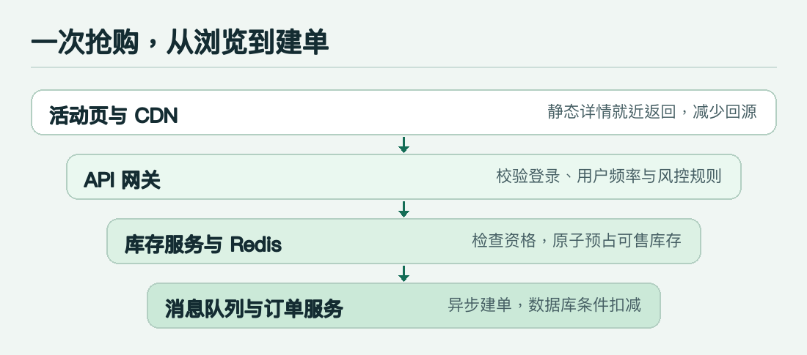
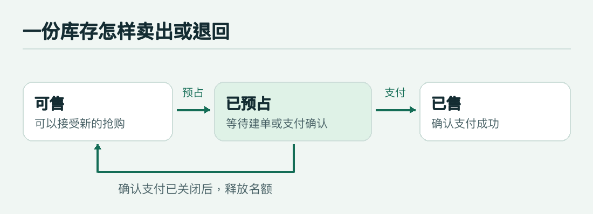

零点前，我在手机上看倒计时。后台还有另一块屏幕，显示的是应用线程、数据库连接和库存。零点一到，前一块屏幕开始转圈，后一块屏幕里的数字一起往上窜。等系统缓过来，团队才发现 1,000 台手机已经多卖了 47 台。

<!-- more -->

我按《一小时掌握高并发架构》的 33 页课件顺序，把这场秒杀从事故到压测重新走了一遍。复盘时我会同时追两条线。**一条看请求是不是还在等，另一条看系统有没有把同一件货许给两个人。** 文中的课程数字用来还原算例，另外补出的取舍和边界会单独说清。

| 视频位置 | 课件范围 | 回看时要解决的问题 |
| --- | --- | --- |
| 00:00–13:00 | 第 1–9 页 | 故障怎么发生，并发、吞吐和响应时间怎样计算，开工前怎么估容量 |
| 13:00–22:54 | 第 10–14 页 | 五层缓存怎么放，什么时候回源，缓存与数据库怎样处理旧值 |
| 22:54–48:44 | 第 15–25 页 | 怎样设线程池和流量阈值，什么时候异步、扣库存、加锁或扩容 |
| 48:44–60:03 | 第 26–33 页 | 一次抢购的 11 个步骤，怎样压测和从小到大落地 |

## 一、从超卖 47 台开始　00:00–13:00

### 00:00–04:53　原来平时快的接口也会在第一秒垮掉

开场先画出一张大促流量图。十万级请求从入口进来，静态资源在 CDN 返回，网关拒绝超额流量，本地缓存和 Redis 承接重复读，消息队列平摊必要的写，最后才由数据库处理必须落地的那部分。整堂课分成四段。先算容量，再处理读流量，然后保护处理资源，最后把所有件放回一笔秒杀订单里。

事故里有 **10 万人蹲点，1,000 台手机**。Spring Boot 单体平日峰值不到 300 QPS，零点第一秒来了约 **8 万个下单请求**。连接池只有 50 个连接，后来的请求只能排队。排队让响应变慢，前端超时再次发起请求，后台还在处理第一次，又得接住第二次。视频描述全站不可用约 **20 分钟**。

等流量过去，库存又出了一件独立的事。代码先查库存、判断有货，再跑一条更新。课件把查库存和扣库存分别举成 0.3 秒和 0.2 秒。中间只要有间隙，几个同时进来的请求就可能都读到「还剩 1 台」。团队盘点时发现超卖 47 件，还得为这些订单善后。我把两个失败条件记在一起：**连接排队会让请求办不完，分开的判断和扣减会让办完的结果也出错。**

### 04:53　看监控时，我会先问这三个数字的口径

| 指标 | 我想从它知道什么 | 读数时最容易漏掉的条件 |
| --- | --- | --- |
| 并发数（Concurrency） | 此刻还有多少请求在途 | 先说在哪一层数。应用里办事的线程、等待池连接的请求、客户端仍在等的请求，口径各有范围 |
| QPS | 一秒处理多少个请求 | 接口 QPS、入口请求速率和全站业务事务 TPS 要分别统计 |
| 响应时间（RT） | 一次请求从进入到结束花多久 | 从用户侧测会包括排队。线程占用时间只统计线程在处理或阻塞中被占着的那段 |

在近似稳定的区间内，**平均在途量 ≈ 每秒完成量 × 平均响应时间（秒）**。每秒完成 2,000 次、平均耗时 0.1 秒，就有约 200 个在途请求。同样的吞吐下，如果平均耗时涨了一倍，系统里需要容纳的在途量也约翻倍。流量刚开始猛涨、请求持续积压的时候，这个关系适合拿来看趋势，容量还得结合实际队列和监控。

### 06:43　为什么一条 SQL 慢十倍，整台机器也可能慢下来

课里用阻塞式 Tomcat、200 个工作线程做估算。一个线程处理一个请求，中间等数据库时仍占着名额。假设每次占 50 毫秒，单线程每秒可周转 20 次，200 条线程约 **4,000 QPS**。如果占用涨到 500 毫秒，200 ÷ 0.5 就只剩 **400 QPS**。第 201 个同时需要线程的请求可能得等上一位交还线程。课件还用每条线程约 1 MB 的栈空间提醒，盲目开线程会花内存，具体开销随 JVM 配置而变。

这个除法算的是**线程层理论上限**。换回开场的 50 个连接，CPU 很空、线程够多，请求也可能全卡在等连接。排查时我会把 RT 拆开，分别看线程队列时间、连接池等待、数据库执行和下游等待。总耗时告诉我顾客等久了，细分耗时告诉我该去哪里找。

### 08:12　为什么大家说「又是数据库先报警」

1. **连接预算要在实例之间分。** 课件以 MySQL 151 个连接、应用实例的连接池 10 个连接举例。十个实例就可能占去约 100 个，其他服务、管理连接和突发余量还得算。实际值由部署配置决定。
2. **同一热点行的写入要竞争锁。** 一万个用户都抢同一款手机，加连接并不会让一万次对同一行的更新一起成功。事务拖得越久，后面的请求等得越久。
3. **查询可能触发磁盘访问。** InnoDB 先利用缓冲池。索引缺失或扫描过大时，查询可能读大量数据页，还可能挤走原本常用的页。一次大扫描能同时拖慢许多原来很快的小查询。

### 09:44　把每一层要吃的流量先写出来

课件用入口 **100,000 QPS** 到数据库约 **800 QPS** 做分层示意。具体分摊取决于真实流量。商品图和活动页交给 CDN，超额调用交给网关快速拒绝，重复的商品查询交给缓存，必要的写通过消息队列按消费者能力消化。应用实例可以复制扩展，前提是任意一台都能处理同一位顾客的下一次请求。

我会把这些动作记成三个可分别验证的结果。缓存是否减少重复读？异步和限流是否让系统按容量接活？加入新实例后，吞吐有没有提高，还是所有实例一起去排同一条数据库的队？

### 11:08　容量账从 100 万日活算到 2,800 QPS

| 步骤 | 课件算例 | 工程上接下来要做什么 |
| --- | --- | --- |
| 估日总量 | 日活 100 万 × 人均 20 次 = 2,000 万次请求 | 用历史数据修正，同时区分浏览与下单 |
| 估忙时平均 | 80% 流量集中在 20% 的时间，1,600 万 ÷ 17,280 秒 ≈ 926 QPS | 用每秒或每分钟曲线找真实尖峰 |
| 加峰值系数 | 926 × 3 ≈ 2,800 QPS | 系数由业务决定。整点秒杀比普通电商忙时更集中，课程给出了 3–5 倍及更高的讨论范围 |
| 分配各层预算 | 应用留出余量，数据库按缓存未命中读和必要写估算 | 应用可用约 70% 水位估实例数。课件对读回源举了低于 10% 的目标，写入仍要另外算 |

2,800 是设计目标。后面那组 JMeter 数据会告诉我它有没有落在能稳定运行的区间里。

## 二、我刷新的是同一张商品页　13:00–22:54

### 13:00–15:03　缓存每靠近用户一层，就省掉后面一段工作

| 缓存位置 | 适合放什么 | 要记住的代价 |
| --- | --- | --- |
| 浏览器 | 带明确版本或有效期的图片、样式 | 复用时请求可停在用户设备，更新要靠缓存头或版本变化 |
| CDN | 大图、静态页面、活动规则 | 边缘命中不用回源，内容改动需要发布新版本或刷新 |
| 网关 | 相同参数且允许共享的热点响应 | 可以做短期缓存或合并请求。含身份或权限的返回值需要隔离 |
| 应用本地缓存 | 最热、读多写少、容忍短暂延迟的数据 | Caffeine 直接读 JVM 内存，省网络往返。容量、过期和多实例版本差异都要考虑 |
| Redis | 要在多个实例之间共享的缓存 | 进程外缓存需要网络访问，集中缓存异常时要为回源设上限 |

数据库是最后的权威读取位置。课里举的选型思路是，图片和页面往浏览器与 CDN 放，极热且允许旧一点的数据可以在本地保留，需要跨实例共享的数据再放 Redis。本地缓存多一份就要多管一份，Caffeine 的淘汰策略和容量限制正是为了控制它占用的堆。

我会同时看命中率和回源 QPS。假设有 10,000 次同类读取每秒，95% 命中时回源 500 次，90% 命中时回源 1,000 次。页面看起来可能只晚一点，数据库已经多干了一倍的活。

### 15:03　旁路缓存怎么读，商品改完怎么删

**读路径**先查缓存，命中直接返回。未命中才按商品 ID 查数据库，并把查询结果写回，设置 TTL。课程用商品缓存 30 分钟作例子。查不到也要单独考虑，可以用短 TTL 缓存一个明确的空标记，读到空标记立即返回查无此项。

**写路径**先提交数据库更新，再删除对应缓存。商品卡片可能拼了价格、活动和详情好几份数据，每次写都同步拼整张卡片费事。两个编辑并发时，先完成的旧结果还可能最后覆盖缓存。失效后由下一次读取重建，可以少做无用工作，并减少写入乱序留下旧缓存的机会。

```text
读商品：查缓存 → 未命中 → 读数据库 → 写回并设置有效期
改商品：提交数据库事务 → 删除相应缓存 → 下一次读重建
```

### 17:37　穿透、击穿、雪崩，各自是哪一层漏了

| 故障 | 发生了什么 | 课程里的做法 | 我会关注的边界 |
| --- | --- | --- | --- |
| 缓存穿透 | 一直在查不存在的商品，缓存没结果，库里也没有 | 给空结果短 TTL，例如 60 秒。大量不同无效 ID 可用布隆过滤器先拦一批 | 查无数据和查库报错要区分，错误响应别被当成商品不存在 |
| 缓存击穿 | 一个热点 key 到期，大量并发同时向数据库取同一份数据 | 互斥回源，等一人重建。或使用逻辑过期，先返回可接受的旧值，后台刷新 | 等锁应有时限。返回旧值的策略得获得业务允许 |
| 缓存雪崩 | 一批 key 同时过期，或者 Redis 整体无法服务 | TTL 加随机扰动，例如 30 分钟上下抖动 5 分钟。结合缓存高可用、限流和降级 | 时间抖动只能分散集中到期，节点宕机依然需要保护下游 |

### 21:04　一条旧价格是怎样回到缓存里的

假设价格原来是 3,000 元，准备改成 2,800 元。我用两条时序来检查写入顺序。

- **先删缓存，再更新库。** 写请求删掉缓存，我恰好刷新，未命中后从库里读到 3,000 元。写请求随后提交 2,800 元，而刚才的读请求最后把 3,000 元填回去。下一位顾客还可能看见旧价格，直到下一次删除或过期。
- **先提交数据库，再删缓存。** 两步之间还有一个短窗口，读者可能命中旧缓存。还有一种竞争是，先前已在读库的请求读到旧数据，迟到的回填发生在删除之后。这两处都需要被设计进一致性策略。

**延迟双删**在第一次删除后等一段时间再删一次，清理可能迟到的旧值。课件用 500 毫秒举例，线上延迟要参考真实的读库与回填耗时。缓存删除本身失败，可以通过消息重试，或用订阅数据库 binlog 的方式做异步失效，例如 Canal。TTL 给残留旧值留一个退出机会。到了支付金额、余额检查和最后一份库存这类交易判断，我会回到有事务保证的权威写入路径。

## 三、我按下抢购后，后台会碰到哪些上限　22:54–48:44

### 23:52　线程池要同时回答线程数、队列长度和满了怎么办

CPU 密集任务从核数附近起步，再看调度和压测结果。课程对阻塞式 I/O 任务给出的估算是 **核数 ×（1 + 等待时间 ÷ 计算时间）**。八核、每次计算 100 毫秒、等 400 毫秒，估得 8 × 5 = 40 条线程。这个估算隐含下游有能力接住并发，数据库连接池或第三方接口更小时，还要按它们的容量调整。

课件用这样的线程池配置解释每个参数：

```java
ThreadPoolExecutor executor = new ThreadPoolExecutor(
    40, 60,
    60, TimeUnit.SECONDS,
    new ArrayBlockingQueue<>(1000),
    new ThreadPoolExecutor.CallerRunsPolicy()
);
```

核心线程忙时新任务通常先入队，队列饱和才继续往最大线程数增长。队列一千只是示例，长度应该服从用户能等多久。默认的 AbortPolicy 会抛异常，可在入口转换成明确失败。CallerRunsPolicy 让提交线程执行任务，减缓提交速度，但如果调用线程本身负责响应用户，就得接受它也会被拖慢。固定线程池配无界队列时，高峰的代价会变成延迟和内存积压。

我会一起看**活跃线程、队列长度、拒绝次数**。同一份账也要给数据库连接池、Redis 连接池和 HTTP 连接池各算一次，并给连接与调用设置超时。

### 26:12　同样限 100 次，为什么到秒级会放行 200 次

| 算法 | 我怎样理解它 | 适用情况和边界 |
| --- | --- | --- |
| 固定窗口 | 每分钟允许 100 次，整分钟到了清零 | 实现简单。上一分钟末和下一分钟初各有 100 次，可能短时间通过近 200 次 |
| 滑动窗口 | 把一分钟切成六个十秒小格，统计最近一段时间的总量 | 窗口持续移动，边界更平滑。分桶越细，计数精度和维护成本也越高 |
| 漏桶 | 先排进有界队列，再按固定速度流出 | 下游需要稳定速率时好用。队列满要拒绝，已经排队的请求要等 |
| 令牌桶 | 按速率补充令牌，拿到一个才放行 | 补充速率约束长期平均，已攒下的令牌允许一阵可控突发 |

限流有三个不同的维度。**全站**看总预算，**单机**看一台实例的承受能力，**用户**看单个账户或设备的频率。只盯接口总 QPS，个别用户仍可能占掉大半份额。被拒绝时返回清楚的反馈，例如 HTTP 429，并约束重试，免得每一次拒绝都换来一波新请求。

### 29:05　网关、服务、集群计数分别放规则

网关按 IP、用户、接口做粗筛，越早拒绝越少占用应用资源。服务侧能看业务语义，课程举 Sentinel 的三种处理方式：直接快速失败、冷启动逐步放量（Warm Up）、排队匀速通过。单机规则保护每个进程。全站规则要共用额度，不能简单把每台的阈值都当作全站阈值。

课件还展示了 **Redis 有序集合 + Lua** 的滑动窗口思路。按时间移除窗口外的记录，数剩余记录，没到阈值才写入此次请求并设置过期时间。删旧、计数、判断、写入放在同一段脚本内执行，避免多实例同时数到相同剩余额度而一起放行。阈值可从单机压测拐点的约 80% 开始评估，再按 GC、依赖抖动和产品延迟目标调整。

### 31:10　推荐挂了，我还想付钱

**熔断**针对已经变慢或失败的依赖。关闭状态照常调用并统计慢调用比例、异常比例或异常数。达到阈值后进入打开状态，暂时快速失败。冷却结束转到半开，放少量请求探测，成功则恢复，失败就继续隔离。

**降级**负责告诉用户此时还能做什么。推荐接口挂了，可以回默认精选。评价区暂时隐藏，积分和通知可以延后。写操作如果要返回「排队中」，后端确实得有可追踪的任务。跨服务调用设超时，非核心功能留有清楚的开关和降级结果，避免一条迟迟不回的请求占住整个购买链路。

### 33:54　消息队列把洪峰往后移，积压最后还得消化

课程把同步链路写成下单、扣库存、处理优惠、发通知。请求要等一串工作。把可以延后处理的事交给 RocketMQ 或 Kafka 后，入口可以完成资格检查、预占和可靠投递，向用户返回受理状态。订单服务按数据库能承受的速度消费。积分、通知、物流订阅自己的事件，下单接口就不用一次等齐。

课件用 **每秒到达 8,000 次、消费者每秒处理 2,000 次** 说明削峰。一秒净积压 6,000 条，持续 10 秒就多 60,000 条。之后完全没有新流量也要约 30 秒排空。实际监控还要看**积压条数和最老消息的等待时间**，因为对顾客而言，「排队中」会持续多久比队列里有多少条记录更直接。

三类失败要提前演练：消息丢失要能追踪并补投，消息重投要幂等，事件乱序要按订单状态判断能否应用。同步确认保留给必须立刻知道的结果，异步受理后要能查到最终成功或失败。上游预扣成功却没有可靠发出消息时，要能按冻结记录找到并补偿那份库存。

### 36:35　一条按日期查订单的 SQL，为什么少扫近两百万行

课件对比两种等价的日期过滤方式。假设 create_time 上有适合的索引，第二种写法给数据库一个明确的索引范围。

```sql
-- 对列执行函数，普通时间索引可能无法用于日期范围查找。
SELECT *
FROM orders
WHERE DATE(create_time) = '2026-10-25';

-- 左闭右开的区间同时覆盖当天小数秒。
SELECT order_id, create_time
FROM orders
WHERE create_time >= '2026-10-25 00:00:00'
  AND create_time <  '2026-10-26 00:00:00';
```

课件里前者执行计划为全表扫描，约 200 万行、1.8 秒。后者为范围扫描，约 5,000 行、3 毫秒。这是课程示例。诊断时看实际 EXPLAIN 中的访问类型和预计扫描行数，同时对照真实耗时和数据分布。

我会按这个顺序自查：WHERE 和 ORDER BY 有没有可用索引，联合索引是否满足常用查询前缀，索引列是否被函数、算术或隐式转换包住，是否用了多余的 SELECT *，大偏移量分页能否改成从上一页末尾继续，写事务是否持锁太久。慢查询日志用来做持续治理，例如从高频慢 SQL 里优先改前几条。第一次读很贵就先优化索引，重复读很多再评估缓存，冷热数据差异明显可先考虑归档。

### 38:39　最后一件库存，怎样一次判断并扣减

我和你都读到 1，然后各自把 0 写回去，库存表可能始终没有负数，两张订单却已经产生。这是典型的先检查再操作（check-then-act）竞态。数据库可以把检查条件和扣减放进同一条更新：

```sql
UPDATE seckill_stock
SET stock = stock - 1
WHERE sku_id = ? AND stock > 0;
```

两笔请求竞争同一个 SKU 行，第一笔成功时影响一行，第二笔条件不再满足时影响零行。应用看到零行就走库存不足分支。另一层可以用 Redis 预扣，脚本在一次执行里完成取值、判断和减少库存：

```lua
local stock = tonumber(redis.call('GET', KEYS[1]) or '0')
if stock <= 0 then
    return -1
end
return redis.call('DECR', KEYS[1])
```

**脚本里的 0 是成功拿到最后一份后的剩余量。** 负数返回才是缺货。Redis 在入口守住预占量，数据库条件更新负责真实库存。两层之间的投递、建单和取消仍要靠业务标识、幂等和对账接起来。Redis 预扣解决了第一轮准入，数据库影响行数决定订单能不能继续。

### 41:17　什么时候才轮到分布式锁

Java 的 synchronized 能协调同一 JVM 内的线程。应用若部署了五个实例，五个进程各有一把本地锁。确实要跨机器互斥执行一段操作时，可以让实例使用 Redis 或 ZooKeeper 等共享协调机制。课件用 Redisson 说明常见做法：

- 锁按业务对象取最小范围，例如活动和用户，等待要有截止时间，抢不到就返回可理解的结果。
- 获取锁成功后再执行业务，在 finally 中释放，并校验持有者。简单的 SETNX 手写实现还得处理原子设过期、唯一持有标识、比较后再释放和客户端崩溃。
- 看门狗会在持锁且客户端仍存活时续期。课件用默认约 30 秒租期、约 10 秒检查说明概念。显式指定固定租期的调用要按固定租期理解，业务超出租期要防并行执行。

我会先看能否由数据库约束、条件更新或一段原子脚本解决。最后一件库存的条件更新已经能裁决归属。重复提交的复杂操作、只能跑一份的定时任务等场景，再按需要评估分布式锁。

### 43:48　先分读写，哪些情况才需要分片

**读写分离**把写发主库，把允许滞后的读分给从库。课程以 MySQL 主从复制、应用使用 ShardingSphere 或动态数据源为例。从库有复制延迟。假设我刚改完头像，下一秒打开页面就读到旧值，需要把这类写后读路由到主库。加从库也改变不了同一热点库存行的写入竞争。

**分库分表**让不同分片键上的数据和写入分散到更多节点。假如最常用的查询是「我的订单」，按 user_id 分片可以让一个用户的订单落在一片。若只按时间分片，查某位用户的跨期订单可能要扫多片再合并。还要处理分布式 ID、跨分片分页或聚合、事务补偿、迁移和运维成本。视频举了雪花算法作 ID 方案的例子。

课程给过一些讨论水位，例如单表 500 万到 1,000 万行可先评估归档或分区，写入压测达到单机瓶颈且索引已调好时再评估进一步拆分。是否拆库取决于热点分布、工作集、锁等待、磁盘和延迟目标。如果大部分查询只读近期订单，先把历史订单归档，往往能先减掉很大一块压力。

### 46:41　新加一台应用，为什么顾客反而被登出了

我刚在 A 实例登录，下一次请求被分到 B。会话只存在 A 的内存里，B 就觉得我没登录。用户上传的文件只写本地，切流后也会读不到。多台实例启动同一个定时任务，扩容之后又可能做了好几遍。服务有这类本地状态时，负载均衡还得记住谁该回哪台机器。

课程的做法是会话可放 Redis，例如使用 Spring Session，文件进对象存储，定时任务由分布式调度协调，应用本地缓存只放丢了可以重建的内容。达到这个条件，Nginx 才能让请求自由落到健康实例，Kubernetes 加实例才更容易把容量加上去。

我会做三个实操测试：重启任意实例，购买过程是否断掉？丢掉任意实例的本地文件，已经上传的内容还在吗？把一台机器的流量全切走，有没有哪个功能也跟着切没了？

## 四、跟着这一下点击走完全程　48:44–60:03

### 49:44　秒杀的三道关口分别拦什么

活动入口面对的是十万人，真实库存只有一千份。我先把详情页、规则和图片静态化，再用按钮防重和轻量校验错开密集点击。仍然到达网关的请求要经过登录校验、频率控制和风控。最后，进入秒杀服务的请求按库存发预占名额。抢到名额的请求才值得发建单消息，让订单服务集中处理约一千份可能成交的请求。

课件在图中用了约 80%、90% 和 95% 的分层削减数字，说明剩余流量逐层变少。这些数字是不同层的示意比例，流量构成、命中率、库存量和拦截率要各自实测。分层还有一个好处，哪一层扛不住，就可以优先调整那层的资源或规则。售罄信号也可以向前传播，尽量在边缘结束无效的抢购，及时处理后续补货或名额回流。



*活动页接住浏览，网关决定有多少抢购尝试进来，库存预扣决定哪些尝试值得建单。*

### 51:22　一次抢购，十一件具体的事

| 步骤 | 我在屏幕上能感受到什么 | 后台在确认的事 |
| --- | --- | --- |
| 1. 点下抢购 | 按钮变灰，我知道这次点击已经发出 | 客户端携带一次性 token。服务端仍做校验，重复点击或重放不能产生额外申请 |
| 2. 请求到网关 | 频率过高时早点看到提示 | 验证身份，检查设备风险、黑名单与频率。课件用每用户每秒一次和 HTTP 429 举例 |
| 3. 秒杀服务验资格 | 还没开始、已结束或已经抢过，页面告诉我具体原因 | 校验活动窗口、参与资格和重复参与标记。重复请求的已有结果应能按同一个标识查询 |
| 4. Redis 原子预扣 | 如果拿到名额，我开始等待建单 | Lua 将读库存、判断、扣减合并成原子操作。最后一份的成功返回和售罄返回要区分 |
| 5. 判断售罄 | 名额用完时尽快得知结果 | 预扣失败立即结束。课程建议将售罄信号推向网关、CDN 等更前面的层级，减少无效调用 |
| 6. 投递建单消息 | 页面短时间内显示「排队中」 | 预扣成功后发布建单事件。确认可靠受理后返回状态。课件用约百毫秒说明入口尽快响应 |
| 7. 订单服务幂等消费 | 刷新再多次，订单页仍只有这一笔 | 消费端按订单号或预占编号收敛重复投递，同一业务事件只产生一次建单效果 |
| 8. 数据库扣减真实库存 | 订单有了可核查的结果 | 数据库对真实库存执行带 stock > 0 条件的原子扣减。检查影响行数，协调建单结果与库存变化 |
| 9. 支付或关单 | 课件举例给我 15 分钟支付。超时，订单关闭 | 确认未支付并完成关闭后释放名额。Redis 的 INCR 只是原子相加，业务仍要防止同一关单回流两次 |
| 10. 查询或通知结果 | 订单页告诉我去付款、已经买到或本轮未抢到 | 用户可主动查状态，也可接收通知。通知最终送达与否不影响后台已经保存的订单结果 |
| 11. 事后对账 | 若系统有差异，可以追到对应订单 | 定时核对 Redis 可售量、数据库实际库存和未支付预占，核对前先统一扣减时点，差异要能报警和定位 |

我最关心第 6 步和第 9 步。第 6 步决定了我关掉页面后，能不能找回刚才那次申请。第 9 步决定了我在最后一秒付款时，系统会不会同时把货放回去。这两件事单看压测数字都看不出来，必须主动做故障和并发测试。



*支付是否成功还在核实时，这份库存继续保留。确认支付关闭后，关单和库存回流还需要防重复执行。*

这里给课件的对账例子补一个口径。假设本批 1,000 份里已支付 650 份，另有 150 份预占尚未结算，可售应为 200 份。若数据库在建单时已经把待付款的 150 份扣掉，对账时不能又减一次。用同一时点的 **可售 + 已预占 + 已售 = 活动初始量** 来推导，再对取消、退款和补货单列变更。

### 52:16　页面静态化、防刷和一分钟之前的准备

- **活动页提前生成。** 把商品描述、图片、文案和规则静态化，在开始前推到 CDN。活动真正变化的是能否购买和用户订单状态，用少量动态接口回答。课件用单次动态详情约 200 KB、CDN 命中率 99% 举例，同一类请求的回源量可降到约 1%。
- **减少重复点击和同时抵达。** 按钮防重、一次性 token、轻量答题都可以让一部分点击错开。前端状态改善体验，服务端还需验证 token 和身份。活动时间按服务端的规则确认。
- **在进入业务前处理风控。** 课程提到设备指纹、行为验证、黑名单和限购。一人一单最终还是得有后台约束。真实用户只按一次，后端也可能因为重试收到多次。
- **把下单入口做短。** 每次抢购尝试只完成必要校验和预扣，渲染、推荐、复杂计算都不要挤在同步路径里。就算每次只多等几十毫秒，乘上峰值请求量，也会占掉一大批工作线程。

### 54:05　阶梯压测，拿四档数据对前面那笔容量账

课程用 JMeter 大约每档跑三分钟，同时看吞吐、响应时间和错误率。样例结果如下。

| 并发数 | QPS | 响应时间 | 错误率 | 我在监控上会注意什么 |
| ---: | ---: | ---: | ---: | --- |
| 50 | 920 | 54 ms | 0% | 请求仍较快完成 |
| 100 | 1,740 | 57 ms | 0% | 并发翻倍，吞吐仍有明显增长 |
| 200 | 2,870 | 70 ms | 0% | 达到估算目标附近，RT 开始明显上升 |
| 400 | 2,910 | 137 ms | 0.2% | 吞吐只多 40 QPS，耗时近乎翻倍，开始报错 |

从 200 加到 400，并发翻倍，吞吐只增约 **1.4%**。这档再多来的请求主要在等待。课里把吞吐拐点估在约 2,900 QPS。前面算的 2,800 QPS 离拐点很近，真正上生产还要核对错误预算、尾延迟、稳定运行时间与安全余量。

定位时，先看哪儿先排起队。应用 CPU、线程池与工作队列有无积压？数据库连接等待、慢查询、锁等待何时上升？Redis 和网络有无瓶颈？如果 QPS 不涨而 RT 涨，去找先饱和的资源。如果错误率开始抬头，分清是计划内的限流，还是服务器错误。吞吐还随并发稳步增长、耗时和错误率平稳，才有理由继续加下一档。

三类测试误差特别值得避开。只测白天预热后的系统，会漏掉冷缓存和冷启动。只压一个下单接口，会漏掉浏览、详情和下单比例带来的资源争用。压完也要把测得的水位写回限流、告警和扩容配置，否则容量数字只留在报告里。测试环境的数据量、网络拓扑、缓存状态和读写比例都尽量接近生产。除了平均 RT，可以补看 P95、P99，了解最慢那批用户实际等了多久。

### 55:36　实施顺序，先处理数据和请求，再决定哪层扩容

| 阶段 | 课程建议 | 我会用什么验收 |
| --- | --- | --- |
| 先处理明显瓶颈 | 查慢 SQL、补索引和热点缓存 | 扫描行数、缓存回源、平均和尾部响应时间确实降下来 |
| 保护系统 | 给线程池和等待队列设上限，配限流、超时、熔断、降级，非核心任务异步化 | 超过容量时能快速反馈，核心交易仍能完成，队列能在恢复后排空 |
| 按实际瓶颈扩容 | 先让应用无状态，按情况做读写分离、归档、分片或热点库存预扣 | 新实例能接走流量，数据库没有把瓶颈转移到新位置，库存与订单仍对得上 |

课里最后列了五个常见坑：把变化很快的库存当成普通详情缓存，线程池用无界队列又不设超时，MQ 消费时忘了幂等，用远小于生产的数据压测，以及遇到慢查询和本地状态就急着加机器。每个阶段改完再做一次压测，下一步才有数据可用。

### 57:40–60:03　最后十六个词，拿来遮住右列自测

| 复盘项 | 我应该能说清楚什么 |
| --- | --- |
| 并发数、QPS、RT | 为什么同样的 QPS，耗时增加会让在途量增加 |
| 线程模型 | 为什么阻塞式线程即使只在等数据库，也占用工作线程 |
| 容量估算 | 日请求量怎样变成忙时吞吐，再加峰值系数和实例余量 |
| 流量分层 | CDN、网关、缓存、队列和数据库各留下哪部分请求 |
| 五层缓存 | 五个位置各自适合哪些数据，本地缓存需要付出什么代价 |
| Cache Aside | 读缓存未命中怎么回填，写完数据库为什么删缓存 |
| 穿透、击穿、雪崩 | 不存在的键、一个热点键和一大片键故障应怎样判断和处理 |
| 缓存一致性 | 读写窗口从哪里来，TTL、重试和延迟双删各管什么 |
| 线程池三要素 | 核心线程数、队列边界和拒绝策略怎么一起设置 |
| 四种限流算法 | 窗口边界为什么会突刺，漏桶和令牌桶能接受怎样的突发 |
| 熔断与降级 | 什么时候停调下游，停调后用户还能做什么 |
| 消息队列削峰 | 入队速率高于消费速率时，等待会积在哪里 |
| 原子扣减 | 怎样用一条条件 UPDATE 或 Lua 解决先检查再扣减的竞态 |
| 分布式锁 | 为什么 JVM 内的锁限制不了另一台机器，锁租期和释放怎么处理 |
| 读写分离、分库分表 | 什么是复制延迟，分片键为什么得从高频查询反推 |
| 无状态服务 | 一台实例随时切走，会话、文件和定时任务还应该怎样工作 |

回到开头那 47 台手机。上线前，我会在机房屏幕和用户手机上各做一轮验证。先把浏览、刷新和抢购混在一起压，找出最先排队的资源。再把活动库存设成一份，让两个人同时抢，并重放建单和关单消息。监控能说明大家为什么等，订单和库存才能说明那一件最后去了哪儿。两边的结果都对得上，我才会放心去倒那杯水。
