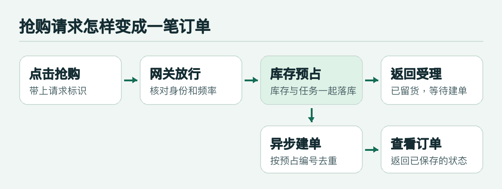

晚上八点，我想抢一件只发售 800 份的商品。倒计时一结束，我点了「立即抢购」，页面转了两秒，跳出一句「正在处理」。我本来打算去倒杯水，又把手机拿了起来。刚才那一下到底收到了没有？如果我再点一次，会不会多出一笔待付款的订单？

<!-- more -->

我想用这个场景推演一套自己愿意用的秒杀系统。假设前三秒来了 12,000 次抢购尝试，库存始终只有 800 份。设计时，我会反复回到一个问题：**现在这个页面上的字，后台有证据这么写吗？**

## 八点之前，我已经把详情页刷了三遍

我会提前进活动页，看规格、地址能不能送，再习惯性地点几下刷新。更新得最勤的是倒计时，我手里的手机自己就能算。商品图和活动说明很早就定了，可以提前生成静态页面，交给浏览器缓存和 CDN。价格和规格要是还会改，我会给它们独立的缓存策略，结算时再确认最终成交价。

活动页上那个「还有名额」只做提示。它可能是几秒前的状态。哪怕两千个人同时看见有货，后台也得等他们真的发出抢购请求，再确认谁拿到了名额。我会把这条边界也做进页面里，免得一句「有货」先替仓库许了愿。

如果每秒有 10,000 次商品详情查询，95% 的缓存命中率意味着每秒约 500 次请求要回源。一旦掉到 90%，回源就变成 1,000 次。我会在看命中率的同一张监控上放回源量。五个百分点听起来挺小，值班的人看到数据库突然多干了一倍的活，感受就很具体。

## 我只想买一件，服务端可能收到好几次点击

12,000 次尝试发生在三秒内，平均每秒 4,000 次。第一秒可能还要尖得多。做容量预算时，我会按秒看峰值，再把商品浏览、抢购和结果查询分开算。抢购接口忙起来的时候，之前已经抢到的人还得能打开订单页。

| 我会在哪里处理 | 这一层先做的事 | 屏幕上可以怎么说 |
| --- | --- | --- |
| 页面 | 提交后暂时禁用按钮。重试时沿用这次操作的请求标识 | 正在提交 |
| 网关 | 检查登录状态，对用户限频，并控制全站进入抢购服务的速率 | 当前请求过多，请稍后再试 |
| 抢购服务 | 检查活动时间和资格，找到这次请求已有的记录，或尝试预占 | 已留货、正在生成订单，或者本轮名额已占满 |
| 结果查询 | 按请求标识或订单号返回已经保存的状态 | 待付款、已支付、已取消 |

按钮置灰只能拦住当前页面那根手指。浏览器超时会重新发，同一个人也能拿两部手机来点。我会让服务端记住同一次请求的标识，认出它来过，就把已有状态还给用户。再给预占记录加上活动和用户的唯一约束，保证换一个标识也占不到第二份。这场活动我设定每人最多拿到一次名额，超时放回的货留给其他人。

如果网关当下忙不过来，我宁愿它尽早给一个明确的提示。进入服务就开始无期限排队的话，我关掉浏览器半分钟后，后台才突然替我做完一笔交易，回来一看难免要愣一下。我还会用有上限的线程池和等待队列，避免延迟上升时仍一味收请求。已经提交成功的用户还得查订单，这点容量应当单独留出来。



*只有预占事务提交后，页面才可以说「已留货」。*

## 最后一份库存，我会在一个事务里划走

假设库存只剩一份。我和你同时点进来，我读到 1，你也读到 1。如果应用各自在内存里算出「1 减 1 等于 0」，再把 0 写回数据库，两次更新都可能执行成功，接着各发一份待付款通知。库存表看上去没什么毛病，出问题的是有两个人等同一件货。

我会让数据库在写入的那一刻再检查库存：

```sql
UPDATE activity_stock
SET available = available - 1,
    reserved = reserved + 1
WHERE activity_id = ? AND available > 0;
```

在同一行上，第一个请求提交后，可售库存变成 0。另一个请求更新时条件已经不满足，影响行数为零。应用要检查更新结果。拿到名额的请求可以继续提交事务，没拿到的就结束这一轮。

我会在同一个数据库事务里做三件事：**记下这位用户的预占、更新库存、保存一条待发送的建单任务**。如果扣减失败，整笔回滚。事务提交之后，接口才可以回「已留货，正在生成订单」。如果客户端没等到这个响应，重试时后台可以靠已有的预占记录回答刚才那一下算不算数。

这套设计先让数据库记一份库存账。网关负责挡住超额请求，售罄提示也可以缓存，但账上的数字只有交易事务能改。要是以后考虑用 Redis 提前预扣，我得先解释清楚每次预扣怎样落到真实库存，失败又怎么补偿。对这个 800 份的活动，我会先测单行扣减的锁等待，看看它在保住延迟的情况下能接多少写入，再决定是否需要多维护一份账。

## 我去倒杯水回来，订单应该查得到

如果预占一成功就同步建单、发通知，再等下游逐个回执，手机上的等待会越来越长。我会让事务里那条待发送记录负责建单的后续工作。这种做法通常叫 **事务性发件箱（Transactional Outbox）**。后台进程读取记录、发送建单消息。发送超时，可以再发一遍。订单服务以预占编号做唯一约束，收到同一条任务两次，也只生成一笔单。

这里最容易漏掉的是这样一秒：订单服务刚把记录写好，准备确认消息，进程就停了。重启后消息又来一遍。对我的手机来说，订单页理应仍然只有一行。用数据库约束做幂等，这个要求就有了可以检验的结果。

队列也有自己的时间账。假如建单消费实测每秒能处理 200 条，800 个名额都已预占，而且同时抵达队列，排空大约需要 4 秒，暂且忽略网络和重试。要是最旧的任务已经等了几分钟，状态页的「稍等片刻」就有点含糊了。我会监控队列里最早一条还没处理的任务等了多久，超过预期及时告警。用户此时关掉页面，回来还可以用同一个入口查看进度。

还要有人处理一直建不成的单。我会给预占到建单设一个独立的超时。确认没有生成可付款的订单后，把这份预占取消并归还库存。建单任务晚到了，就先核对预占还有效，再决定能不能继续。这和后面的十分钟付款期限是两段不同的等待。

## 有人没付款，这一份怎样才能放回去？

抢到以后未必会买。也许我临时发现地址不对，也许我放下手机就把这件事忘了。我会从订单进入待付款时开始给十分钟。超时先把订单置为关单处理中，向支付渠道查明结果。确认已经支付，就继续履约。能确认支付已关闭且未成功，才取消订单、归还一份库存。

最难判断的是我在最后一秒按下「确认支付」。任务调度器可能先发现单子超时，支付成功通知晚一点才送到。如果查单暂时得不到确定答案，我会继续保留这份库存，重试核实。多占几十秒我还能解释。把同一份货释放给下一位，再回来告诉已付款的用户发不了货，就很难解释了。


*付成一单，就把一份已预占库存转为已售。确认支付已经关闭，才把它转回可售。*

我会让订单状态和库存变化在事务里一起提交。比如，关单任务需要先命中「关单处理中」的记录，并确认只更新了一行，才能把已预占减一、可售加一。任务又跑一遍时，那笔订单已经取消，就不会再退第二次。

| 我查到的状态 | 这份货在账上放哪儿 |
| --- | --- |
| 已预占、待付款、关单处理中 | 已预占 |
| 已支付 | 已售 |
| 已取消并释放 | 已归入可售库存 |

拿活动结束前的一刻对账。假设总数是 800，已有 600 份支付，150 份正在等付款或确认关单，账上就应当还有 50 份可售。如果查出来有 51 份，我会顺着预占编号查，看看是哪个任务多退了一次，或者哪一笔状态写进去、库存没跟上。

## 这个活动上线前，我会在手机上试什么？

我会先测高峰结束以后，谁还等不到结果。压测时一起跑浏览、抢购和结果查询。从低流量逐档加，盯着成功率、P95 和 P99 延迟、数据库连接等待、队列最早一条任务等了多久，再看性能开始变坏时哪一层先排队。如果吞吐已经上不去，等待时间却继续涨，我会把入口放行速率设在拐点之前。推荐和评价可以暂时少加载一点，抢到的人仍要能看见订单。

接下来只留一份货，请两个人同时抢。然后把成功那笔的建单消息重发一遍，确认只有一张订单。再让订单在付款与超时交界处卡一下，分别试支付确认先到、关单检查先到、支付查询暂时超时。我想看清这份库存每一步去了哪里，最后能不能和订单一笔笔对上。

做完这些，我再拿起自己的手机点一遍。抢到了，订单页有一笔待付款的单，十分钟从这里开始算。没抢到，页面早点告诉我这轮名额满了。要是还在处理，我可以先去倒那杯水，回来照样知道刚才那一下去了哪里。
